# PM_CSP27
CafeQuick: Cafeteria Pre-Order & Pickup System (SE440 capstone, JUST)

Contents: 1 Run locally | 2 Project in 5 lines | 3 Architecture and file map | 4 Business rules and where they live | 5 Walkthrough of place_order | 6 Concepts you must be able to explain | 7 Order life cycle | 8 Accounts and roles | 9 REST API | 10 Tests | 11 Front end | 12 Gaps vs the brief (be honest in the exam) | 13 Likely exam questions | 14 Presentation outline | 15 Sources to study | 16 Diagrams (PMP 5 and 6; legacy) | 17 CafeQuick — Architecture Diagrams and ADRs

---

## 1. تشغيل المشروع

> الكودات هون نقطة بداية مش اشي رسمي. عدلو عليها زي ما بدكم.

### 1.1 تنزيل الباكجات المطلوبة

بايثون 3.10 او اعلى. شغلو الامر من المجلد الرئيسي للمشروع:

```
pip install fastapi uvicorn pydantic sqlalchemy sqlmodel apscheduler pytest pytest-cov httpx
```

- `sqlmodel` ضروري لملف الداتا بيس، و `pytest` و `pytest-cov` و `httpx` للتستات.

### 1.2 الداتا بيس (اول مرة او لما بدكم ترجعو البيانات الاصلية)

```
python Database/cafequick_db.py
```

- بينشئ ملف `cafequick_test.db` وبيعبيه بيانات تجريبية (20 زبون، 4 موظفين، 10 اصناف، طلبات بكل الحالات).
- انتبهو: بيمسح كل البيانات القديمة قبل ما يعبي من جديد.
- ملف `cafequick_test.db` مش لازم ينرفع على GitHub. ضيفوه على `.gitignore`.

### 1.3 تشغيل الباك ايند

```
uvicorn Backend.main:app --reload
```

- شغلوه من المجلد الرئيسي (مش من جوا مجلد Backend).
- التوثيق التلقائي للـ API بيطلع على: http://127.0.0.1:8000/docs
- لازم يكون بآخر `Backend/main.py` هالسطرين (هني اللي بيفعلو التسجيل وصفحة المحفظة):

```python
from Backend.accounts import make_accounts_router
app.include_router(make_accounts_router(get_db, current_user))
```

### 1.4 تشغيل الفرونت ايند

افتحو تيرمينل جديد:

```
cd Frontend
python3 -m http.server 5500
```

- صفحة الزبون: http://localhost:5500
- صفحة الموظفين (شيف، كاشير، مدير، ادمن): http://localhost:5500/staff.html
- استخدمو `localhost` او `127.0.0.1` مش `0.0.0.0`. الباك ايند بيسمح (CORS) بس لهدول العنوانين، و `0.0.0.0` اصلا ما بيفتح بالمتصفح.
- على ويندوز لو طلع `Python was not found` شغلو الامر من WSL او استخدمو `python` بدل `python3`.
- لو غيرتو ملفات الفرونت وما ظهر التغيير، اعملو Ctrl+F5.

### 1.5 تشغيل التستات

```
pytest Tests --cov=Backend --cov-report=term-missing
```

- شغلوها من المجلد الرئيسي. كل تست بيستخدم داتا بيس مؤقتة، فما بتمس `cafequick_test.db`.
- المطلوب بالـ brief (NFR-08): تغطية 70% على الاقل.

### 1.6 هيكلية المشروع

```
PM_CSP27/
  Backend/
    main.py            الـ API الرئيسي: الطلبات، المطبخ، المحفظة، التقارير، job الطلبات غير المستلمة
    accounts.py        التسجيل (signup) و /me و سجل المحفظة
  Database/
    cafequick_db.py    الجداول + البيانات التجريبية
  Frontend/
    index.html         صفحة الزبون (تسجيل دخول، انشاء حساب، طلب، طلباتي، المحفظة)
    staff.html         صفحة الموظفين (مطبخ، كاشير، تقرير، ادمن)
    common.js          الكود المشترك: الطلبات للـ API، تسجيل الدخول، التابات
    customer.js        شاشات الزبون
    staff.js           شاشات الموظفين
    style.css
  Tests/
    conftest.py        اعدادات التستات (داتا بيس مؤقتة + ساعة ثابتة)
    test_backend.py
    test_accounts.py
```

- تنظيف: اذا لسا موجودين، احذفو `Frontend/app.js` و `Frontend/accounts.py` و `Frontend/test_accounts.py`. هدول نسخ قديمة او مكررة من ملفات موجودة بمكانها الصحيح.

Quick demo path: seed DB, start backend, start front end, sign in as `student1@uni.edu` (page 1), place an order; sign in as `kitchen@uni.edu` (staff page) and mark preparing then ready; as the customer read the pickup code in "My orders"; as `cashier@uni.edu` hand it over with order number and code.

---

## 2. Project in 5 lines

- Web app: customers pre-order food for a 15-minute pickup slot and pay from a campus wallet.
- Kitchen sees a queue by slot; cashier hands over against a 4-digit code and tops up wallets; manager sees a daily report; admin sees the audit log.
- Rules that cost money or fairness (slot capacity, stock, wallet, refunds, strikes) are enforced in the back end inside one database transaction, never only in the browser.
- Stack: FastAPI (Python) + SQLModel/SQLAlchemy + SQLite (dev/tests) or PostgreSQL (pilot) + plain HTML/CSS/JavaScript + APScheduler + pytest.
- Sign-in is simulated SSO (e-mail in the `X-User-Email` header). No passwords exist.

---

## 3. Architecture and file map

Three tiers: browser front end -> REST API (modular monolith, one deployable) -> relational DB. One extra component: a scheduled job inside the API process.

| File | Responsibility |
|---|---|
| `Database/cafequick_db.py` | Tables (SQLModel), CHECK constraints, partial unique index, engine (`DATABASE_URL` env var, default SQLite), seed data |
| `Backend/main.py` | App, CORS, `get_db`, `current_user`, `require_role`, `_audit`, all endpoints, `_refund_order`, `mark_uncollected_orders`, scheduler |
| `Backend/accounts.py` | `/signup`, `/me`, `/wallet/history` via `make_accounts_router` (a factory, avoids circular import with main.py) |
| `Frontend/common.js` | `api()` request helper, sign-in, tabs per role, one delegated click listener, 15 s auto-refresh |
| `Frontend/customer.js` | Slots, menu, cart, my orders, wallet, sign-up |
| `Frontend/staff.js` | Kitchen queue, withdraw, cashier, report, stock editor, audit, job button |
| `Tests/conftest.py` | Temp DB per test, frozen clock (`CLOCK`, `FakeDatetime`), helpers (`make_user`, `make_item`, `add_order`, `balance_and_ledger`) |
| `Tests/test_backend.py`, `Tests/test_accounts.py` | Requirement-named tests |

Data model (money is integer fils, 1 JD = 1000 fils):
User 1-0..1 Wallet; Wallet 1-* WalletTransaction (ledger); User 1-* Order; Order 1-* OrderLine (price snapshot); Order 0..1 Strike; MenuItem 1-* OrderLine; AuditEntry (actor nullable = system).

---

## 4. Business rules and where they live

| Rule | Brief | Enforced in | Proven by |
|---|---|---|---|
| 1 to 5 lines, qty 1 to 5 | FR-03 | `OrderIn`/`LineIn` (Pydantic) + DB CHECK `qty_1_to_5` | `test_more_than_5_lines_rejected`, `test_quantity_above_5_is_422` |
| Slot on 15-min grid, 08:00 to 14:45 start | FR-03 | `place_order` | `test_invalid_slot_is_422` |
| At least 20 min ahead | FR-03 | `place_order` | `test_slot_less_than_20_minutes_ahead_is_422` |
| Max 20 orders per slot | FR-03 | `place_order` count + PG advisory lock | `test_slot_capacity_is_20_objective2` |
| One order per customer per slot | FR-03 | `place_order` check + partial unique index `one_order_per_slot` | `test_one_order_per_customer_per_slot`, `test_reorder_same_slot_after_cancel` |
| Pay from wallet, never below 0 | FR-04 | `place_order` + CHECK `wallet_non_negative` | `test_wallet_never_below_zero_...` |
| Stock reserved at order, released at cancel | FR-10 | `place_order`, `_refund_order` + CHECK `stock_non_negative` | `test_stock_is_never_oversold_objective2`, cancel tests |
| Cancel until 15 min before slot, only if `placed` | FR-05 | `cancel_order` | `test_cancel_before_window_...`, `test_cancel_after_window_is_409` |
| Kitchen placed -> preparing -> ready, customer notified | FR-06 | `_kitchen_transition` (notify is a log stub) | `test_kitchen_flow_and_pickup_code` |
| Pickup needs correct 4-digit code, cashier only | FR-07 | `pickup_order` (`compare_digest`) | same test |
| Ready order, slot_start + 35 min passed -> uncollected, no refund, strike | FR-08 | `mark_uncollected_orders` | `test_uncollected_orders_get_strike_...` |
| 3 strikes in 30 days -> blocked 7 days | FR-09 | `mark_uncollected_orders`, checked in `place_order` | same, `test_two_strikes_do_not_block`, `test_old_strikes_...` |
| Daily report | FR-11 | `daily_report` | `test_daily_report_numbers` |
| Withdraw item, refund `placed` orders only | FR-12 | `withdraw_menu_item` | `test_withdrawal_refunds_only_...` |
| Cashier top-up | FR-13 | `topup_wallet` | `test_topup_...` |
| Tags shown | FR-14 | `_menu_dict`, customer.js | `test_customer_sees_only_...` |
| Audit log | FR-16 | `_audit` inside each transaction, `/audit` | `test_audit_log_...` |
| Roles | FR-01 | `require_role` (401 then 403) | `test_role_is_enforced_403` |

The 35 minutes = 15-minute slot length + 20-minute grace. Know this number.

---

## 5. Walkthrough of place_order (the core of the project)

1. `require_role(customer)`: 401 if header missing/unknown, 403 if not a customer.
2. Cheap checks outside the transaction: 20 minutes ahead, grid and hours, not blocked.
3. `with db.begin()`: everything below commits together or rolls back together. Raising `HTTPException` rolls back.
4. PostgreSQL only: `pg_advisory_xact_lock(slot timestamp)` serializes orders for the same slot, so two requests cannot both read "19 orders".
5. Count non-cancelled orders in slot (>= 20 -> 409). Count customer's orders in slot (-> 409).
6. For each line, in `item_id` order: `SELECT ... FOR UPDATE` the item, check available and stock, decrement, add price x qty to total. Sorted order prevents deadlocks.
7. Lock wallet row, check balance (-> 402), subtract, add ledger row (kind payment, negative).
8. Insert Order (random 4-digit code with `secrets`), flush to get the id, insert OrderLines with price snapshot, set ledger reference `order:<id>`, add audit row.
9. Commit. Return id and total.

Why `current_user` calls `db.commit()`: its SELECT auto-starts a transaction on the shared session, and `with db.begin()` fails if one is open.

---

## 6. Concepts you must be able to explain

- **Transaction (ACID)**: money, stock and slot checks are one unit. Partial failure leaves nothing changed (test: wallet 500, cheap item + expensive item -> 402, stock of cheap item unchanged).
- **Row locks `FOR UPDATE`** and **lock ordering**: prevent lost updates and deadlocks. SQLite ignores them (one writer at a time), so the concurrency test is a smoke test only.
- **Advisory lock**: needed because "count orders in slot" has no row to lock.
- **Defense in depth**: Pydantic validation -> API checks -> DB CHECK constraints. Even buggy code cannot make a negative wallet or negative stock.
- **Ledger**: balance is a cached sum of `WalletTransaction` rows; `balance_and_ledger()` in tests asserts they match. `ledger_sign` CHECK stops wrong-sign rows.
- **Integer fils**: no floating point error with money.
- **Price snapshot** in `OrderLine.price`: later price edits do not change old orders.
- **Partial unique index** (`WHERE state != 'cancelled'`): one active order per customer per slot, but re-ordering after cancel works (this was a bug that returned 500).
- **Pickup code hidden until ready** and **never sent to kitchen**: kitchen cannot hand over by itself; only cashier verifies.
- **`secrets.compare_digest`**: constant-time compare.
- **Audit with `actor_id = None`** for system actions (scheduled job).
- **Scheduler**: APScheduler cron every minute, hours 7 to 15. One uvicorn worker only, otherwise each worker runs the job (still correct because of locks, but wasteful).
- **Idempotent job**: second run finds nothing (state already changed).
- **Frozen clock in tests**: business rules depend on time; `FakeDatetime` is patched into `main`. Note `accounts.py` uses the real clock (see `test_me_returns_strikes_30d`).
- **Event delegation** (front end): one `document` click listener handles every `data-action` button, including buttons created later by `innerHTML`.
- **`esc()`**: escapes text before `innerHTML` (XSS, OWASP A03).

---

## 7. Order life cycle

| From | To | Trigger | Function |
|---|---|---|---|
| (new) | placed | customer POST /orders | `place_order` |
| placed | cancelled | customer cancel (>= 15 min before slot) or kitchen withdraws an item | `cancel_order`, `withdraw_menu_item` |
| placed | preparing | kitchen | `_kitchen_transition` |
| preparing | ready | kitchen, sets `ready_at`, notifies | `_kitchen_transition` |
| ready | collected | cashier with correct code | `pickup_order` |
| ready | uncollected | job, slot_start < now - 35 min; strike, no refund | `mark_uncollected_orders` |
| placed or preparing | cancelled | job, same cutoff, kitchen never finished; full refund, NO strike, audit `ORDER_EXPIRED_REFUND` | `mark_uncollected_orders` (extra rule, not in the brief) |

---

## 8. Accounts and roles

Sign-in is a simulated single sign-on (NFR-03): the page sends the e-mail in the `X-User-Email` header and the backend looks it up. No password exists anywhere. The real system would use the university OpenID Connect provider (Keycloak is the planned test provider).

Each page accepts only its own kind of account. A staff account on `index.html`, or a customer account on `staff.html`, is refused with a message.

| E-mail | Role | Page | Notes |
|---|---|---|---|
| `student1@uni.edu` to `student20@uni.edu` | customer | `index.html` | Wallets start with 50, 75 or 100 JD. |
| `student20@uni.edu` | customer | `index.html` | Wallet is 0 JD, used for "insufficient balance" tests. |
| `student10@uni.edu` | customer | `index.html` | Blocked for 7 days (three strikes), used for FR-09 tests. |
| `kitchen@uni.edu` | kitchen | `staff.html` | Queue by slot, preparing, ready, withdraw an item. |
| `cashier@uni.edu` | cashier | `staff.html` | Hand over by pickup code, wallet top-up. |
| `manager@uni.edu` | manager | `staff.html` | Daily report, menu stock. |
| `admin@uni.edu` | admin | `staff.html` | Audit log, run the uncollected-orders job by hand. |

Staff accounts exist only in the seed data. Sign-up creates customers only (role is not read from the request body).

Warning: letting a customer pick their own opening balance (max 100 JD) is a demo feature and contradicts FR-13 (only a cashier loads wallets). Controlled by `ALLOW_SELF_FUNDING` in `Backend/accounts.py`; `False` = only 0 JD accepted.

---

## 9. REST API

All endpoints except `/signup` need the `X-User-Email` header. Interactive docs: `http://127.0.0.1:8000/docs`. Errors: 401 unknown user, 403 wrong role or rule (blocked, wrong code), 404 missing, 409 state/capacity/stock conflict, 402 insufficient balance, 422 validation.

| Method and path | Role | Requirement | What it does |
|---|---|---|---|
| `POST /signup` | public | FR-01, FR-04 | Create a customer account with an opening balance. |
| `GET /me` | any | FR-01 | Name, role, wallet balance, block status, strikes in 30 days. |
| `GET /wallet/history` | any | FR-04 | Balance and the last 30 ledger rows. |
| `GET /menu` | any | FR-02, FR-14 | Customers see available items in stock. Kitchen, manager and admin see all. |
| `POST /menu` | manager | FR-02 | Create an item. |
| `PUT /menu/{id}` | manager | FR-02 | Edit name, price, tags; can re-enable but not hide an item. |
| `PUT /menu/{id}/stock` | manager | FR-02 | Set today's stock. |
| `POST /menu/{id}/withdraw` | kitchen | FR-12 | Withdraw an item, refund orders not yet being prepared. |
| `GET /slots` | any | FR-03 | The 28 pickup slots with taken and remaining places. |
| `POST /orders` | customer | FR-03, FR-04, FR-10 | Place an order: slot, stock and wallet checks in one transaction. |
| `GET /orders/mine` | customer | FR-05, FR-06 | Own orders; the pickup code appears only when the order is ready. |
| `POST /orders/{id}/cancel` | customer | FR-05 | Cancel until 15 minutes before the slot; refund and restore stock. |
| `GET /kitchen/queue` | kitchen | FR-06 | Open orders of today by slot. |
| `POST /orders/{id}/preparing` | kitchen | FR-06 | placed to preparing. |
| `POST /orders/{id}/ready` | kitchen | FR-06 | preparing to ready, customer notified (currently a log stub). |
| `POST /orders/{id}/pickup` | cashier | FR-07 | Hand over against the 4-digit code. |
| `POST /wallet/topup` | cashier | FR-13 | Add money to a customer wallet. |
| `GET /reports/daily` | manager | FR-11 | Orders, collected, uncollected, cancelled, revenue, top 3 items. |
| `GET /audit` | admin | FR-16 | Audit log, newest first, optional `action` filter. |
| `POST /admin/run-uncollected-job` | admin | FR-08, FR-09 | Run the uncollected-orders job now. |

Report definitions: an order belongs to the day of its `slot_start`; revenue = collected + uncollected totals (cancelled were refunded, others not final); top items = by quantity in non-cancelled orders, name as tie-breaker.

---

## 10. Tests

Run: `pytest Tests --cov=Backend --cov-report=term-missing`. Each test gets a fresh SQLite file; the clock starts Monday 2026-11-09 07:00 and tests move `CLOCK["now"]`.

Groups: auth/roles, menu, ordering rules, cancellation, kitchen + pickup, top-up, uncollected job, withdrawal, manager CRUD, report, audit, concurrency smoke test, DB-constraint tests, accounts. Each test name carries the requirement or objective it proves (use this for the traceability matrix).

Objective 2 ("never overfill, oversell, or go below zero") is proven by: slot capacity test, stock test, wallet test, concurrency test, plus the DB CHECK constraints.
Objective 3 ("simulated week") is proven by the job tests and the admin "run job" endpoint.

---

## 11. Front end

- Two static pages, no framework. `data-page` on `<body>` tells `common.js` which account type the page accepts.
- `api(method, path, body, opts)` is the only function that calls `fetch`; it adds `X-User-Email`, shows toasts, and writes the last response into the "developer" box.
- `GET /me` after sign-in gives role and balance; tabs are built from the role (`TABS`). Backend still enforces roles (the UI is convenience, not security).
- Cart is built in the DOM (`#lines`); total is computed from `menuCache`; Place order is disabled when the cart is empty, the wallet is too low, or the user is blocked.
- Accessibility (NFR-06): skip link, focus outline, 44 px buttons, state shown as text not only colour, `aria-live` toast, `prefers-reduced-motion`.
- Email stored in `sessionStorage` to survive reload.

---

## 12. Known limitations and gaps vs the brief

These are limitations of the current prototype. A passing test suite does not mean these operational or integration requirements are complete.

### Security and identity
- **Authentication is simulated, not secure SSO:** the API trusts the caller-supplied `X-User-Email` header. A client can forge it. University OpenID Connect (OIDC), token validation and server-side identity derivation are not implemented. Do not expose this prototype to untrusted users.
- **Transport security is not configured:** local development uses HTTP. TLS/reverse-proxy configuration is still required for a real deployment.
- **Security assurance is incomplete:** no documented OWASP Top 10 assessment or penetration test has been completed (NFR-04).

### Database and concurrency
- SQLite ignores `SELECT ... FOR UPDATE`. The development/test implementation now serializes SQLite order-placement transactions with a process-local lock. This protects the current single-process test setup only; it is not a distributed or multi-worker lock.
- PostgreSQL uses a transaction-scoped advisory lock for slot capacity, but the concurrency suite has **not yet been run against PostgreSQL**. PostgreSQL behavior for slot capacity, stock reservation and wallet debit remains unverified.
- SQLite is the default local/test database. PostgreSQL is the intended pilot database; production migration, backup and restore procedures still need verification.
- The slot capacity (20) is duplicated in backend and frontend code and should eventually be moved to shared configuration/API data.

### Integrations and operations
- Ready-order notification is a `print`/log stub; no e-mail or push provider is integrated (FR-06 is partial).
- APScheduler runs inside the API process. Run one Uvicorn worker in the current deployment model; multiple workers can start duplicate schedulers. A dedicated scheduler worker or distributed coordination is needed before scaling workers.
- Hourly backups and a restore rehearsal (NFR-09), availability measurement/monitoring (NFR-02), load testing (NFR-01), and one-command deployment (NFR-10) have not been demonstrated.
- Browser compatibility evidence (NFR-07) and a formal WCAG accessibility audit (NFR-06) have not been recorded.
- Five-year transaction retention and privacy controls (NFR-05) need a defined and implemented policy.

### Functional scope and project decisions
- Loyalty points (FR-15, Could) are not implemented.
- Self-funding during sign-up is enabled in the prototype and conflicts with the cashier-only wallet top-up rule (FR-13). Disable it before a pilot.
- The code automatically refunds stuck `placed`/`preparing` orders after the timeout. This behavior is additional to the brief and requires TA/sponsor confirmation.
- The `/signup` and strike information in `/me` are prototype additions; confirm their acceptance and security requirements.
- Slot capacity is 20 in both `Backend/main.py` and `Frontend/customer.js`; the values can drift.
- The Gantt dates are planning placeholders (week 1 = 2026-10-05), not verified actual completion dates.
- Generative-AI use must be declared in the project appendix as required by the brief (tool, purpose and what the team changed/reviewed).

### Test evidence (local run, 20 November 2026)
- `python3 -m pytest Tests --cov=Backend --cov-report=term-missing`: **46 passed, 0 failed**.
- Backend statement coverage: **98%** (377 statements, 9 missed); `Backend/main.py` 98%, `Backend/accounts.py` 96%.
- The run emitted 91 deprecation warnings. These were warnings, not test failures.
- The concurrency test passed on SQLite with the process-local lock. This is not evidence of PostgreSQL or multi-process concurrency correctness.
- Coverage is a result from this specific local run; rerun the command after code changes and retain the terminal report as evidence.

---

## 13. Likely exam questions (short answers)

1. How do you guarantee a slot never exceeds 20 orders? One transaction, count inside it, PostgreSQL advisory lock per slot, test with 21 users.
2. How is a negative wallet prevented? Balance check under row lock + CHECK `balance >= 0`.
3. Why a ledger? Auditability; finance can reconcile; balance == sum of rows.
4. Why integers for money? Exactness (constraint in 29.3.5).
5. A customer cancels 14 minutes before the slot. Result? 409, window closed.
6. Kitchen withdraws an item that is in a `preparing` order. Result? Order untouched; only `placed` orders are refunded.
7. When does a ready order become uncollected? When `slot_start + 15 + 20` minutes have passed (job runs every minute).
8. What happens at the third strike within 30 days? `blocked_until = now + 7 days`; `place_order` returns 403. A running block is not extended.
9. Why does the kitchen not see the pickup code? Prevents handing over without the customer; cashier verifies.
10. Why is the clock frozen in tests? Rules depend on time.
11. What would you change for production? Real OIDC, PostgreSQL, real notifications, backups, HTTPS reverse proxy, remove self-funding.
12. Why a modular monolith? Small team, one deployable, easy to test (ADR in PMP 5).
13. Change request scenario (Section C): trace FR -> design element -> code -> test using sections 4 and 10, then show the change-control steps from PMP 4/14.
14. Calculations (Section B: business case, earned value, risk reserve) use your own PMP figures; they are not in this repo. Re-derive them from your PMP 0, 7, 10 before the test.

---

## 14. Presentation outline (every member must speak; 6 marks)

1. Problem and goal, objectives (sponsor view).
2. Process: life cycle, schedule, cost, risk (PMP 2, 6, 7, 10).
3. Architecture: diagrams 1 to 3, ADRs.
4. Data model and the order state machine (diagrams 4, 5).
5. Core rules demo logic: place_order walkthrough (section 5).
6. Live demo: sign up, order, kitchen, ready, pickup, report, uncollected job via admin button, 3-strike block (`student10`).
7. Test evidence and coverage; security and gaps (section 12).
8. Lessons learned and closure.

---

## 15. Sources to study

Official:
- FastAPI tutorial (dependencies, security, testing): https://fastapi.tiangolo.com/tutorial/
- SQLModel: https://sqlmodel.tiangolo.com/
- SQLAlchemy 2.0 (sessions, transactions, `with_for_update`): https://docs.sqlalchemy.org/en/20/
- PostgreSQL explicit locking and advisory locks: https://www.postgresql.org/docs/current/explicit-locking.html
- SQLite partial indexes: https://www.sqlite.org/partialindex.html
- APScheduler user guide: https://apscheduler.readthedocs.io/
- pytest fixtures and monkeypatch: https://docs.pytest.org/
- OWASP Top 10: https://owasp.org/www-project-top-ten/
- OpenID Connect Core: https://openid.net/specs/openid-connect-core-1_0.html
- WCAG 2.1 quick reference: https://www.w3.org/WAI/WCAG21/quickref/
- C4 model: https://c4model.com/
- Mermaid syntax: https://mermaid.js.org/

Book (the official treatment of transactions, isolation, locks): Kleppmann, Designing Data-Intensive Applications, chapter 7.
Course side: PMBOK Guide (PMI) and SWEBOK V4 (IEEE Computer Society) for the PMP sections.

---

# 16. CafeQuick diagrams (PMP section 5 and 6)

Mermaid source. GitHub renders these blocks directly. To get images for the PDF, paste a block into
https://mermaid.live and export PNG/SVG (check it is readable when printed, as the brief requires).
Status: written from the brief and the current code; not yet reviewed by the team.
Diagrams 12 and 13 were added with the account pages; diagram 2 was updated for the two front-end pages.

## 1. C4 level 1: system context

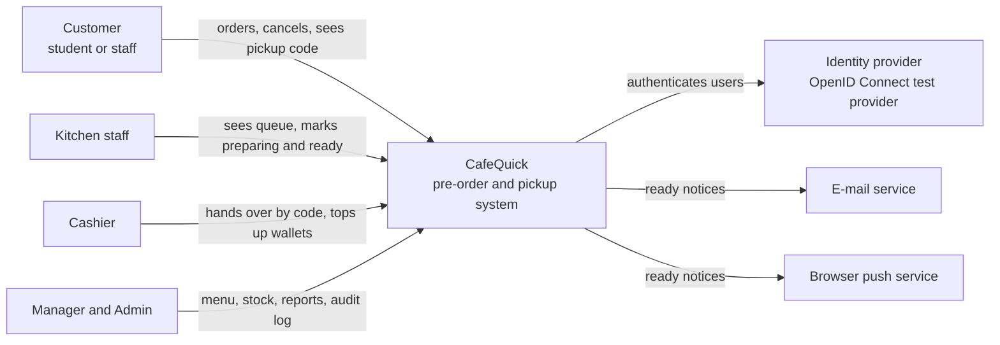

## 2. C4 level 2: containers

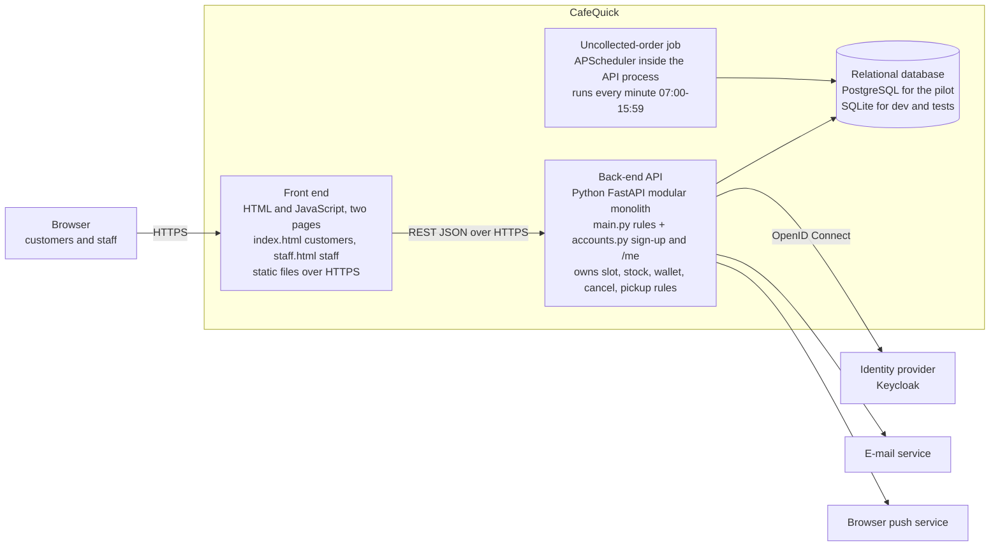

## 3. Deployment view

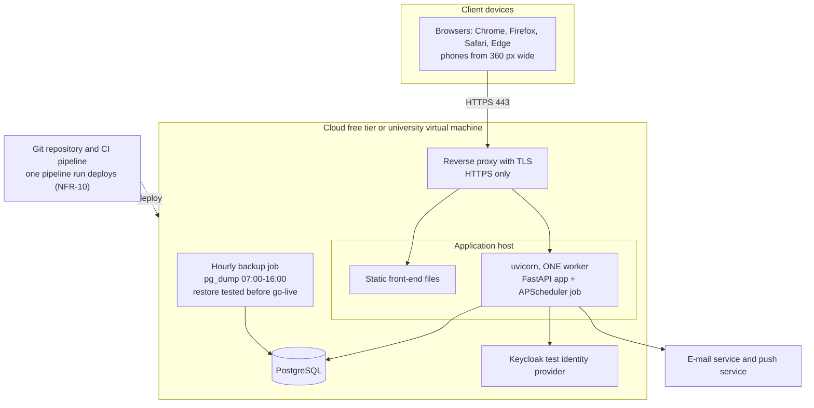

## 4. Entity-relationship diagram (matches Database/cafequick_db.py)

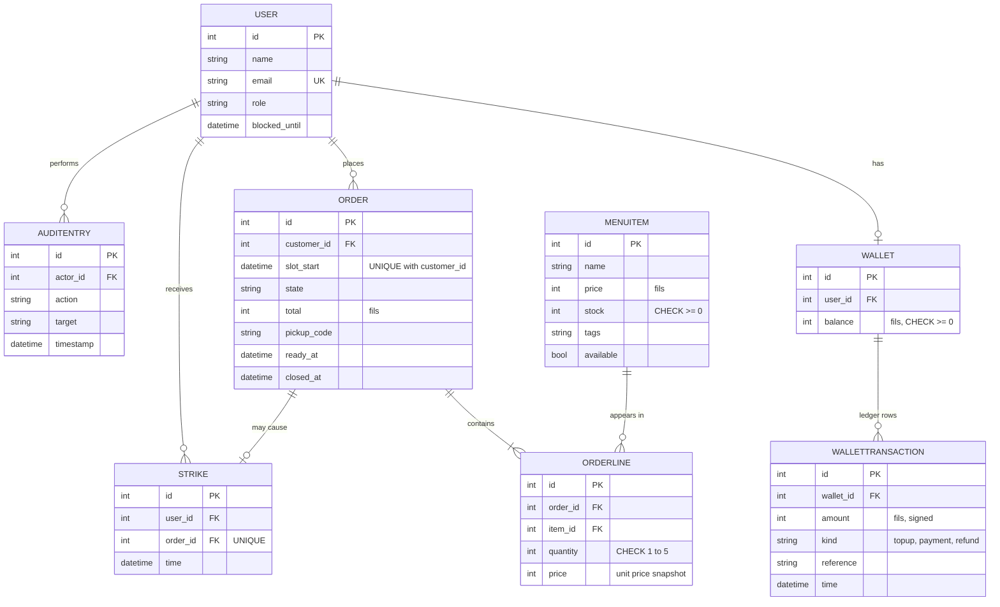

## 5. Order state machine

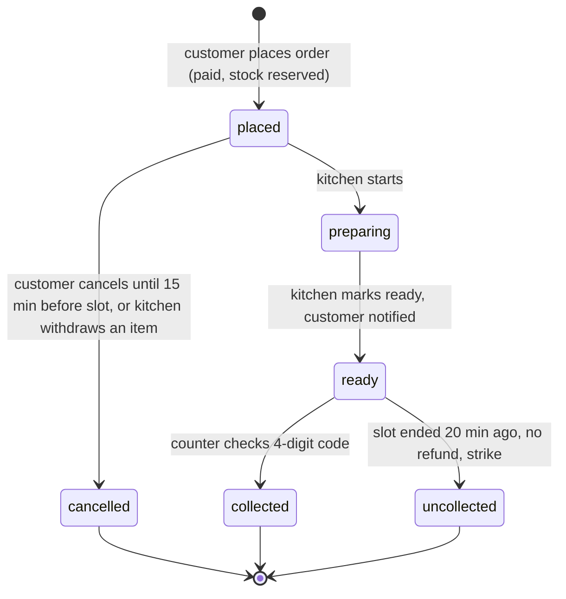

## 6. Sequence: place an order (slot, stock, wallet checks)

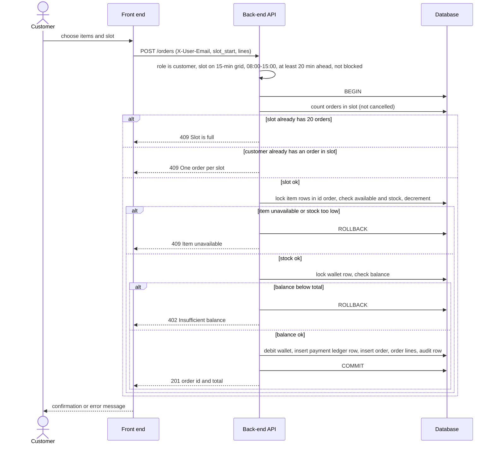

## 7. Sequence: counter pickup

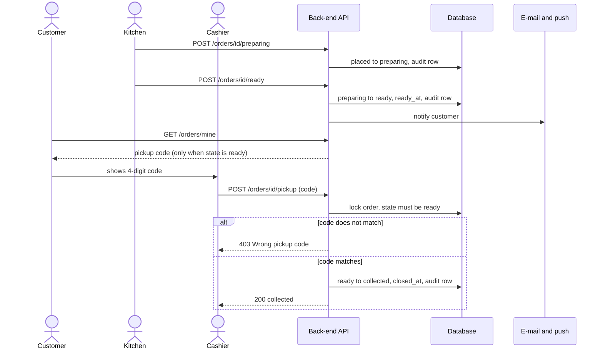

## 8. Sequence: uncollected-order job

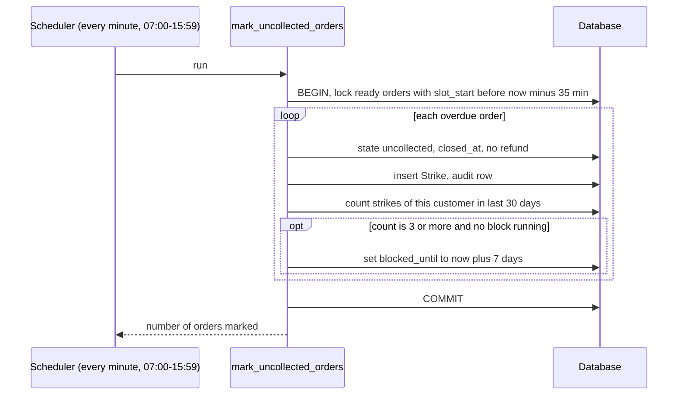

## 9. Schedule: Gantt (PMP section 6)

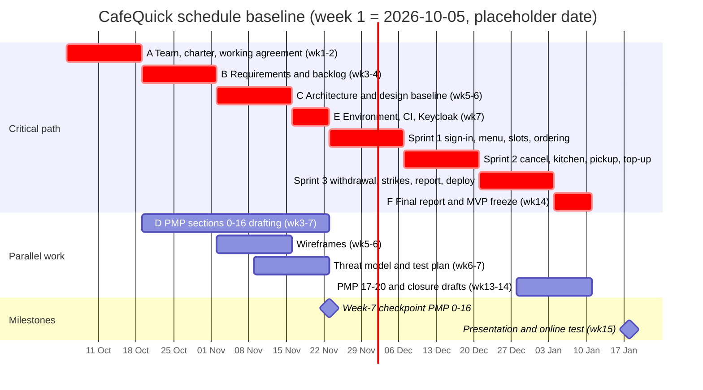

## 10. Schedule: network and critical path (PMP section 6)

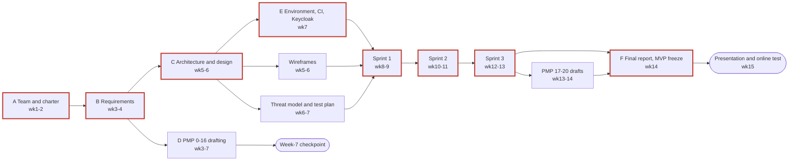

## 11. Low-fidelity wireframes (five main screens)

These are the planned layouts from the brief. The built pages also have a sign-in and create-account screen (wireframe 6) and a customer wallet screen.

Screen 1: Customer, menu and order

```
+------------------------------------------+
| CafeQuick           student1@uni.edu  [x]|
+------------------------------------------+
| Menu                                     |
| [ ] Falafel Sandwich  1.000 JD  vegan    |
|     qty [-] 1 [+]     stock 58           |
| [ ] Chicken Shawarma  2.500 JD  halal    |
|     qty [-] 0 [+]     stock 40           |
| Allergens: gluten, dairy (tap item)      |
+------------------------------------------+
| Pickup slot:  ( ) 12:00  3 left          |
|               (x) 12:15  9 left          |
|               ( ) 12:30  full            |
+------------------------------------------+
| Total 1.000 JD   Wallet 49.000 JD        |
|            [ Place order ]               |
+------------------------------------------+
```

Screen 2: Customer, my orders

```
+------------------------------------------+
| My orders                                |
+------------------------------------------+
| #14  12:15   PLACED      1.000 JD        |
|      [ Cancel ]  (until 12:00)           |
| #12  11:45   READY       2.500 JD        |
|      PICKUP CODE:  4 8 2 1               |
| #09  yesterday  UNCOLLECTED  strike 1/3  |
+------------------------------------------+
```

Screen 3: Kitchen queue

```
+------------------------------------------+
| Kitchen queue                  Withdraw  |
+------------------------------------------+
| 12:00 slot                               |
|  #11  2x Shawarma, 1x Coffee             |
|       [ Preparing ]                      |
|  #12  1x Falafel     PREPARING           |
|       [ Ready ]                          |
| 12:15 slot                               |
|  #14  1x Falafel     [ Preparing ]       |
+------------------------------------------+
```

Screen 4: Cashier

```
+------------------------------------------+
| Cashier                                  |
+------------------------------------------+
| Pickup:  order # [ 12 ]  code [ ____ ]   |
|                       [ Hand over ]      |
+------------------------------------------+
| Top-up:  customer e-mail [____________]  |
|          amount (fils)   [______]        |
|                       [ Add to wallet ]  |
+------------------------------------------+
```

Screen 5: Manager, daily report

```
+------------------------------------------+
| Daily report      day [ 2026-11-09 ]     |
+------------------------------------------+
| Orders 4   Collected 1   Uncollected 1   |
| Cancelled 1          Revenue 8.600 JD    |
+------------------------------------------+
| Top items:  1 Falafel 4                  |
|             2 Shawarma 2                 |
|             3 Coffee 1                   |
+------------------------------------------+
| Menu and stock [ edit ]                  |
+------------------------------------------+
```

Screen 6: Customer, create account (added with the account pages)

```
+------------------------------------------+
| [ I have an account ] [ Create account ] |
+------------------------------------------+
| Create an account                        |
| Full name        [____________________]  |
| University e-mail [___________________]  |
| Starting wallet balance (JD) [ 10 ]      |
|   [ 5 JD ] [ 10 JD ] [ 20 JD ] [ 50 JD ] |
| Demo setting. Maximum 100 JD.            |
|            [ Create account ]            |
+------------------------------------------+
| Chef or cashier? Staff sign-in           |
+------------------------------------------+
```

## 12. Sequence: create account and sign in (accounts.py)

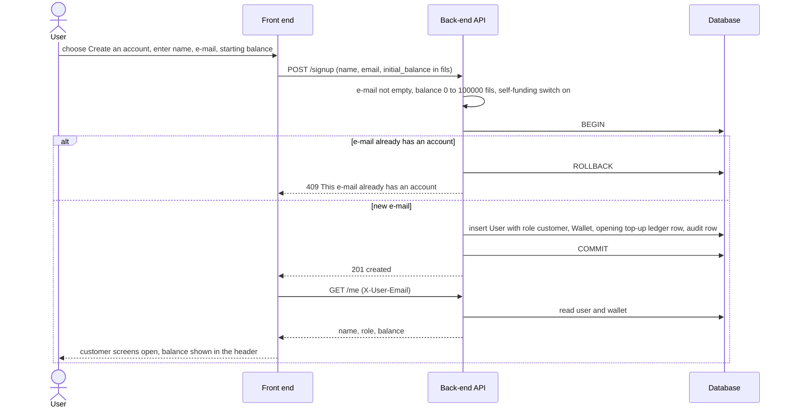

## 13. Flow: which page and screens each role gets

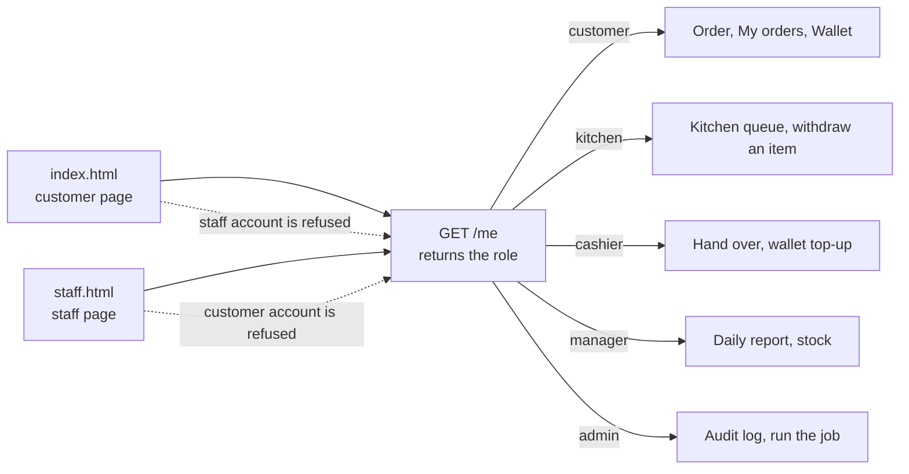


---

# 17. CafeQuick — Architecture Diagrams and ADRs

This section is the reviewed architecture baseline for the current prototype. It supersedes the older, optimistic context/deployment drawings in Section 16 where they imply integrations or infrastructure that are not implemented. Dashed arrows mean planned or not integrated. The diagrams describe the current implementation unless explicitly labelled target.

## 17.1 Review findings and status

- **Identity:** the current API trusts the `X-User-Email` request header. This is a development simulation, not authentication. University OpenID Connect (OIDC) is planned but not integrated.
- **Notifications:** the ready-order notification is currently a print/log stub. No e-mail or push provider is integrated.
- **Runtime:** the system is a modular monolith: static frontend, FastAPI API, account router and APScheduler job. The scheduler runs in the API process; use one Uvicorn worker in the current deployment model.
- **Database:** SQLite is the default for development/tests. PostgreSQL can be selected through `DATABASE_URL`; PostgreSQL advisory locking is used conditionally for slot serialization. SQLite tests do not prove PostgreSQL concurrency correctness.
- **Operations:** TLS/reverse proxy, hourly backups and restore rehearsal, monitoring, OWASP assessment and automated deployment are target/pilot requirements, not verified operational capabilities.
- **Business-rule note:** the implementation also has an automatic refund path for stuck `placed`/`preparing` orders. This is additional behavior beyond the brief and needs TA/sponsor confirmation.

## 17.2 D1 — System context

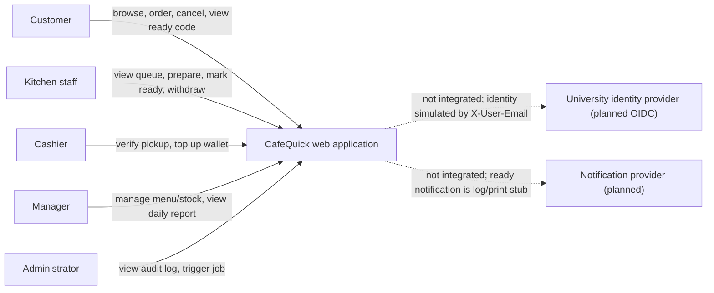

## 17.3 D2 — Container / logical architecture (implemented)

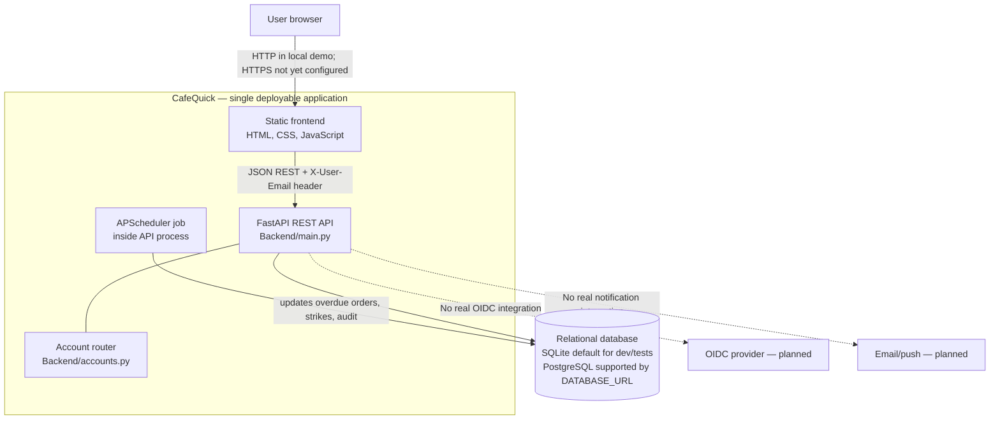

## 17.4 D3 — Deployment view (target, not yet verified)

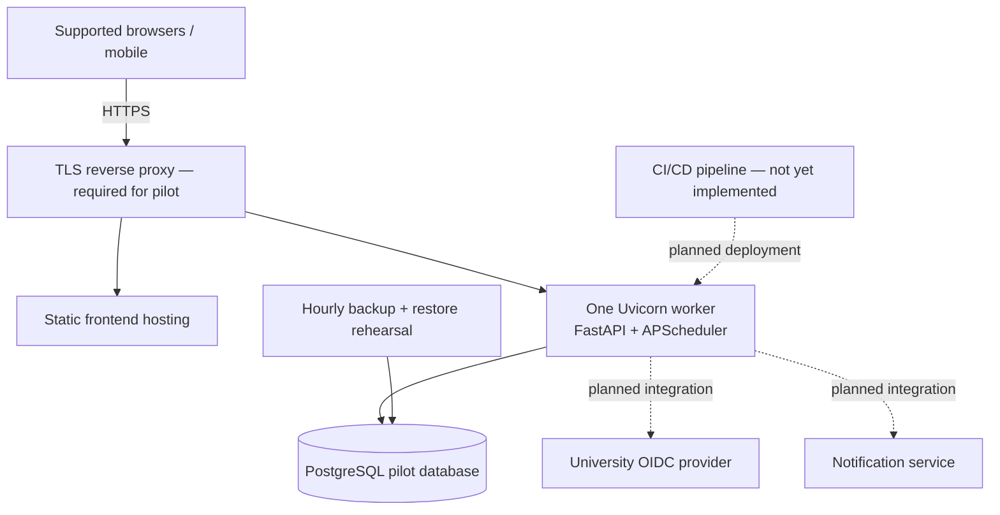

## 17.5 D4 — Entity relationship diagram

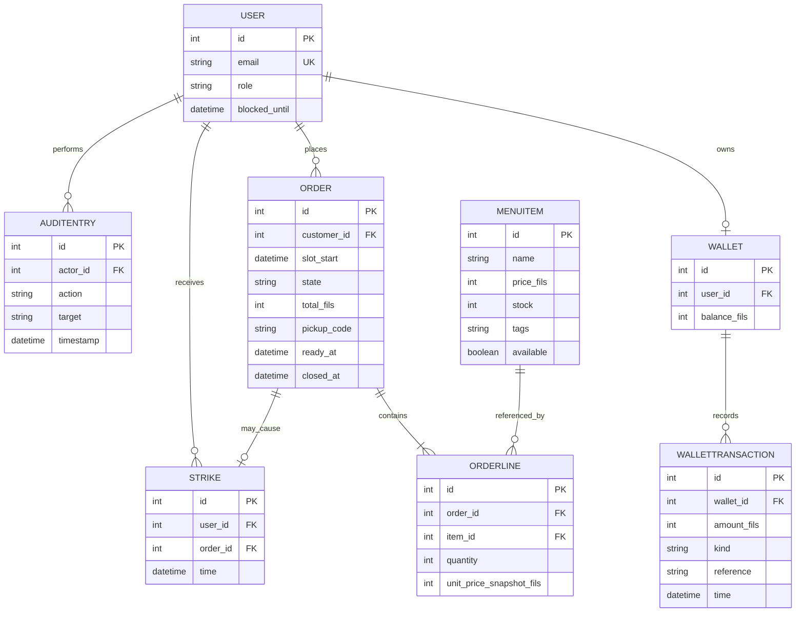

## 17.6 D5 — Order lifecycle

```mermaid
stateDiagram-v2
    [*] --> placed : customer order accepted
    placed --> preparing : kitchen starts
    preparing --> ready : kitchen marks ready
    ready --> collected : cashier verifies pickup code
    ready --> uncollected : cutoff reached; strike; no refund
    placed --> cancelled : customer cancellation / kitchen withdrawal
    preparing --> cancelled : system timeout refund rule (extra implementation)
    cancelled --> [*]
    collected --> [*]
    uncollected --> [*]
```

## 17.7 D6 — Place-order sequence and transaction boundary

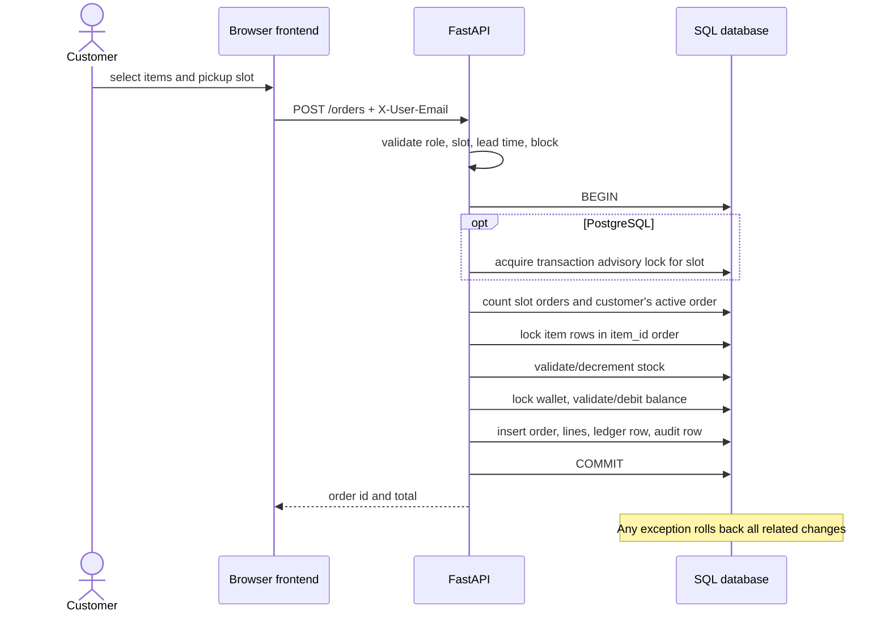

## 17.8 D7 — Kitchen ready and cashier pickup

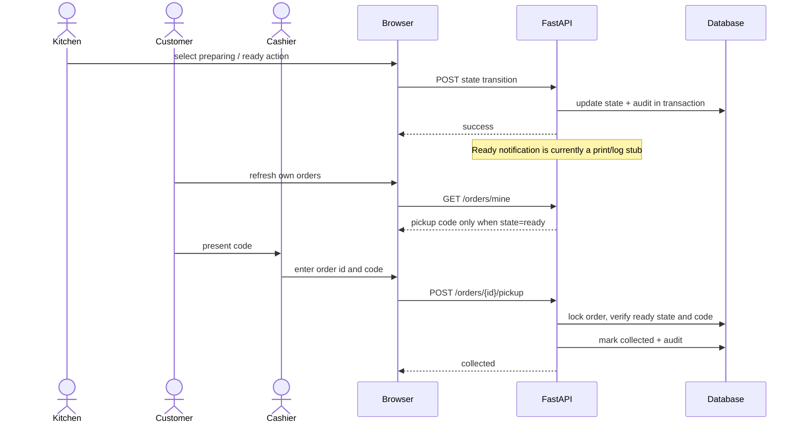

## 17.9 D8 — Scheduled uncollected-order processing

```mermaid
sequenceDiagram
    participant APS as APScheduler
    participant JOB as mark_uncollected_orders
    participant DB as Database
    APS->>JOB: invoke every minute in configured hours
    JOB->>DB: begin transaction / select overdue orders
    loop each eligible order
      JOB->>DB: lock order and re-check state/cutoff
      JOB->>DB: ready -> uncollected; insert strike and audit
      opt third strike in rolling 30 days
        JOB->>DB: set blocked_until (7 days) if no active block
      end
      opt placed/preparing timeout rule
        JOB->>DB: refund, restore stock, cancel and audit
      end
    end
    JOB->>DB: commit
    Note over APS,DB: Run one application worker in current deployment model
```

## 17.10 Architecture Decision Records (ADRs)

### ADR-001 — Modular monolith
**Status:** Accepted. Keep one FastAPI deployable with separate modules/routers. This fits a small capstone team and preserves shared transaction boundaries. Trade-off: modules share one deployment and must maintain clear interfaces.

### ADR-002 — Relational persistence with SQLModel / SQLAlchemy
**Status:** Accepted. Use relational tables and constraints; SQLite for local development/tests and PostgreSQL for pilot. The domain requires transactions, foreign keys and constraints. SQLite does not prove PostgreSQL row-lock behavior; PostgreSQL integration tests are required.

### ADR-003 — Atomic order placement and database-enforced invariants
**Status:** Accepted. Reserve stock, debit wallet, create order/lines, ledger and audit records in one transaction. PostgreSQL uses a transaction advisory lock per slot and row locks for stock/wallet. Validate the concurrency strategy against PostgreSQL before pilot.

### ADR-004 — Static browser frontend with REST/JSON API
**Status:** Accepted. Use static HTML/CSS/JavaScript pages calling FastAPI. The backend remains authoritative for authorization and business rules. Client-side checks are usability only, never security controls.

### ADR-005 — Simulated identity in development; OIDC for pilot
**Status:** Temporary development decision; production decision pending. Current `X-User-Email` is forgeable. Replace it with university OIDC, validate tokens and derive identity server-side. This is a pilot release blocker.

### ADR-006 — APScheduler in the API process
**Status:** Accepted for prototype; deployment constraint. Run the job inside the API process and use one Uvicorn worker. For multi-worker deployment, move scheduling to a dedicated worker or add distributed coordination.

### ADR-007 — Integer fils and wallet transaction ledger
**Status:** Accepted. Store money as integer fils and record top-up/payment/refund ledger rows. Reconcile cached wallet balance to ledger totals and test concurrent spending.

### ADR-008 — Notification integration deferred
**Status:** Accepted as prototype limitation; implementation pending. Ready notification is a print/log stub. Select and integrate an e-mail/push provider before claiming FR-06 notification delivery is complete.

## 17.11 Architecture sign-off checklist

- [ ] Team reviews diagrams against current code and agrees the target architecture.
- [ ] TA/sponsor confirms the additional placed/preparing timeout-refund behavior.
- [ ] Replace `X-User-Email` with university OIDC before a real-user pilot.
- [ ] Select and implement the notification channel; then update D1, D2 and D7.
- [ ] Verify PostgreSQL concurrency for slot capacity, stock reservation and wallet debit.
- [ ] Add evidence for TLS, backups/restore, CI/CD and monitoring before updating the deployment view to implemented.
- [ ] Record ADR authors, dates and team-approved amendments.
