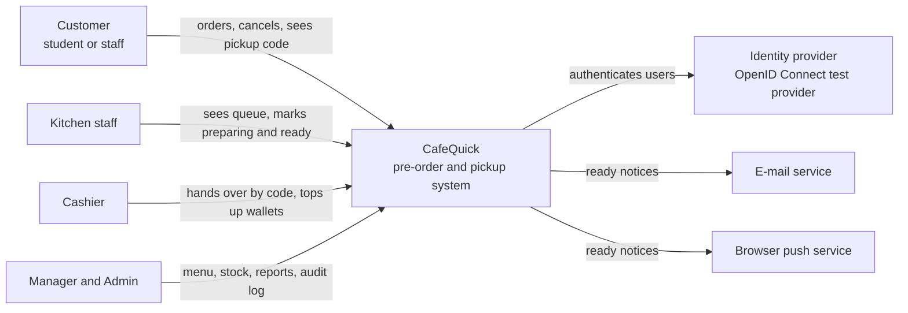
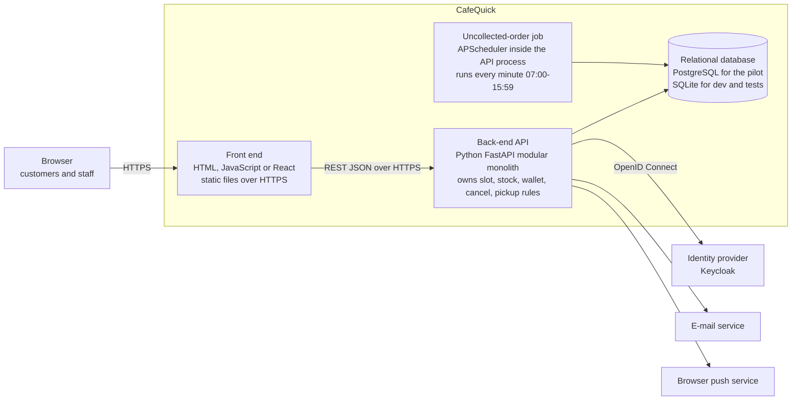
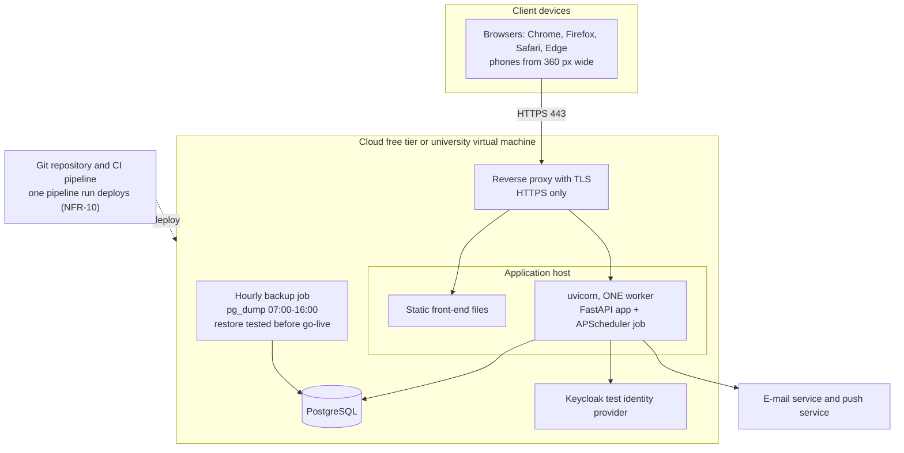
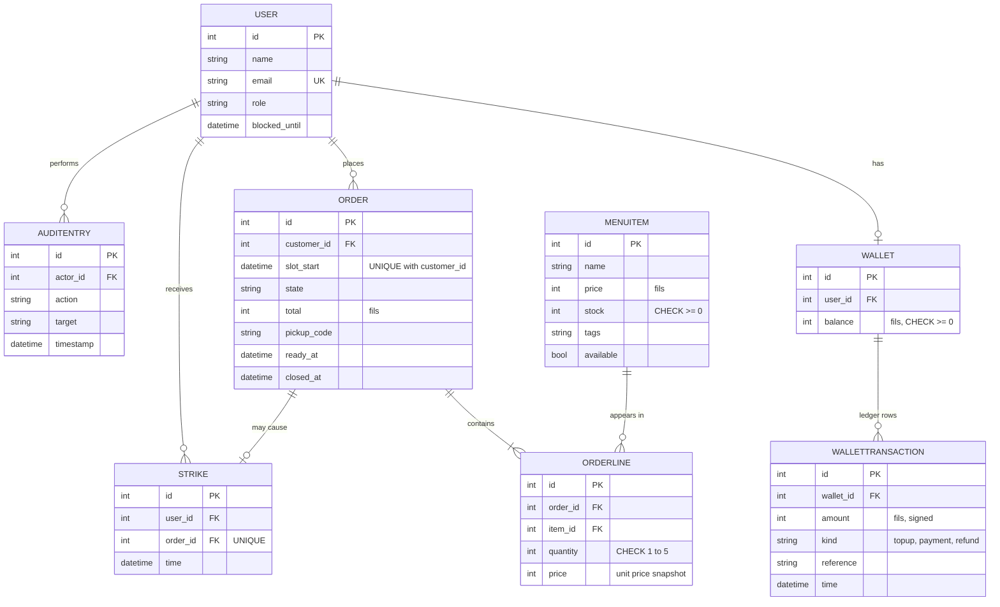
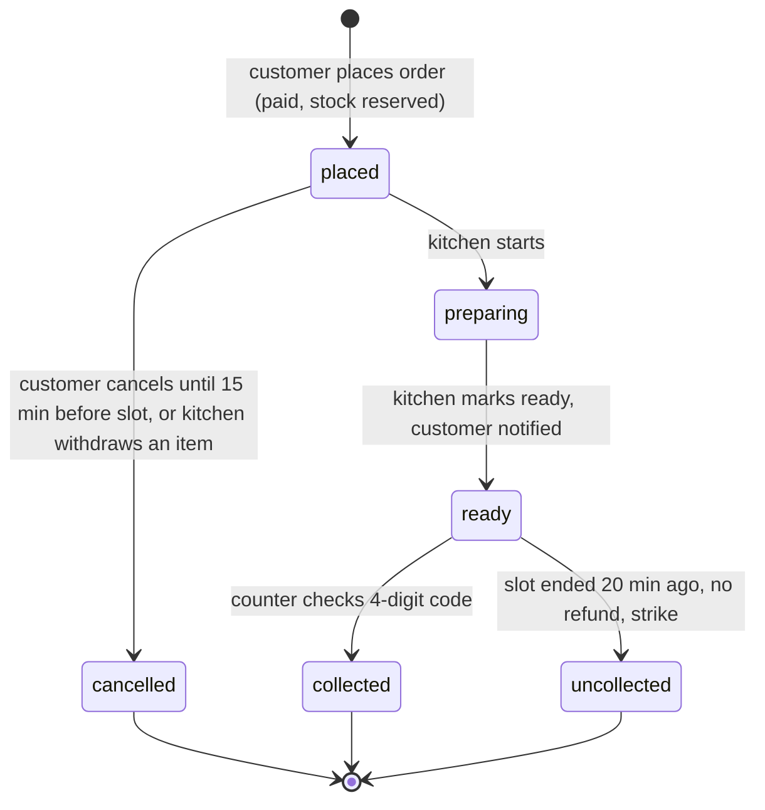
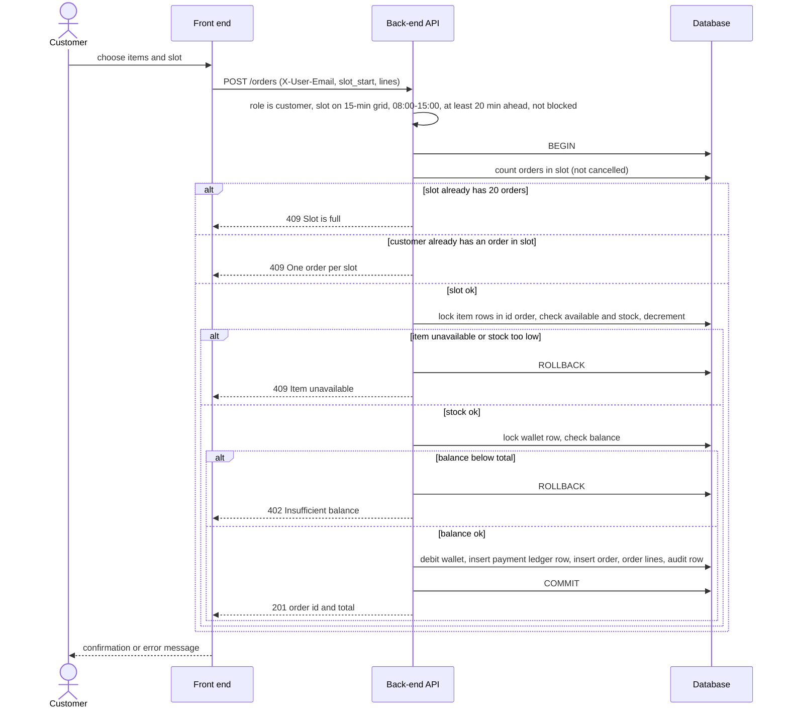
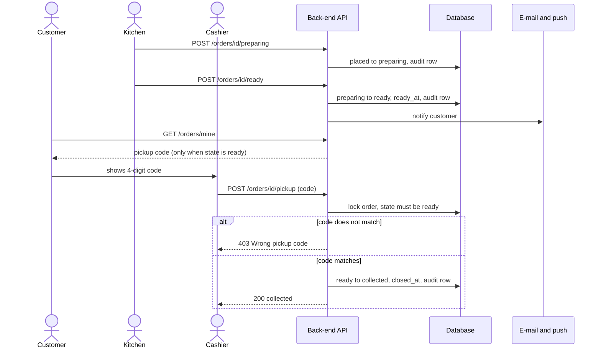
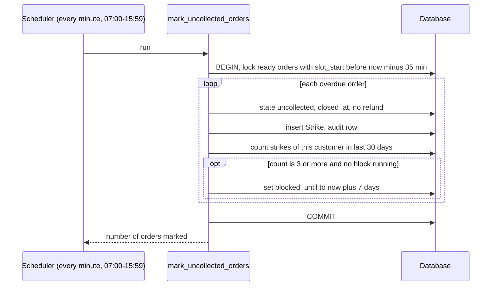
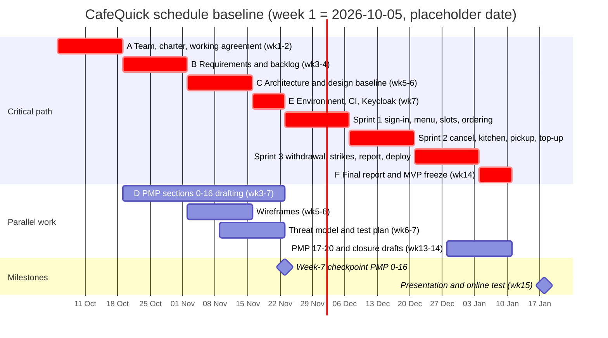
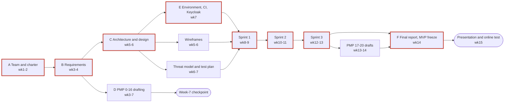

# CafeQuick diagrams (PMP section 5 and 6)

Mermaid source. GitHub renders these blocks directly. To get images for the PDF, paste a block into
https://mermaid.live and export PNG/SVG (check it is readable when printed, as the brief requires).
Status: written from the brief and the current code; not yet reviewed by the team.

## 1. C4 level 1: system context



## 2. C4 level 2: containers



## 3. Deployment view



## 4. Entity-relationship diagram (matches Database/cafequick_db.py)



## 5. Order state machine



## 6. Sequence: place an order (slot, stock, wallet checks)



## 7. Sequence: counter pickup



## 8. Sequence: uncollected-order job



## 9. Schedule: Gantt (PMP section 6)



## 10. Schedule: network and critical path (PMP section 6)



## 11. Low-fidelity wireframes (five main screens)

Screen 1: Customer, menu and order

```
+------------------------------------------+
| CafeQuick           student1@uni.edu  [x]|
+------------------------------------------+
| Menu                                     |
| [ ] Falafel Sandwich  1.000 JD  vegan    |
|     qty [-] 1 [+]     stock 58           |
| [ ] Chicken Shawarma  2.500 JD  halal    |
|     qty [-] 0 [+]     stock 40           |
| Allergens: gluten, dairy (tap item)      |
+------------------------------------------+
| Pickup slot:  ( ) 12:00  3 left          |
|               (x) 12:15  9 left          |
|               ( ) 12:30  full            |
+------------------------------------------+
| Total 1.000 JD   Wallet 49.000 JD        |
|            [ Place order ]               |
+------------------------------------------+
```

Screen 2: Customer, my orders

```
+------------------------------------------+
| My orders                                |
+------------------------------------------+
| #14  12:15   PLACED      1.000 JD        |
|      [ Cancel ]  (until 12:00)           |
| #12  11:45   READY       2.500 JD        |
|      PICKUP CODE:  4 8 2 1               |
| #09  yesterday  UNCOLLECTED  strike 1/3  |
+------------------------------------------+
```

Screen 3: Kitchen queue

```
+------------------------------------------+
| Kitchen queue                  Withdraw  |
+------------------------------------------+
| 12:00 slot                               |
|  #11  2x Shawarma, 1x Coffee             |
|       [ Preparing ]                      |
|  #12  1x Falafel     PREPARING           |
|       [ Ready ]                          |
| 12:15 slot                               |
|  #14  1x Falafel     [ Preparing ]       |
+------------------------------------------+
```

Screen 4: Cashier

```
+------------------------------------------+
| Cashier                                  |
+------------------------------------------+
| Pickup:  order # [ 12 ]  code [ ____ ]   |
|                       [ Hand over ]      |
+------------------------------------------+
| Top-up:  customer e-mail [____________]  |
|          amount (fils)   [______]        |
|                       [ Add to wallet ]  |
+------------------------------------------+
```

Screen 5: Manager, daily report

```
+------------------------------------------+
| Daily report      day [ 2026-11-09 ]     |
+------------------------------------------+
| Orders 4   Collected 1   Uncollected 1   |
| Cancelled 1          Revenue 8.600 JD    |
+------------------------------------------+
| Top items:  1 Falafel 4                  |
|             2 Shawarma 2                 |
|             3 Coffee 1                   |
+------------------------------------------+
| Menu and stock [ edit ]                  |
+------------------------------------------+
```
